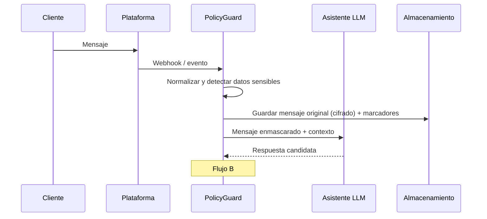
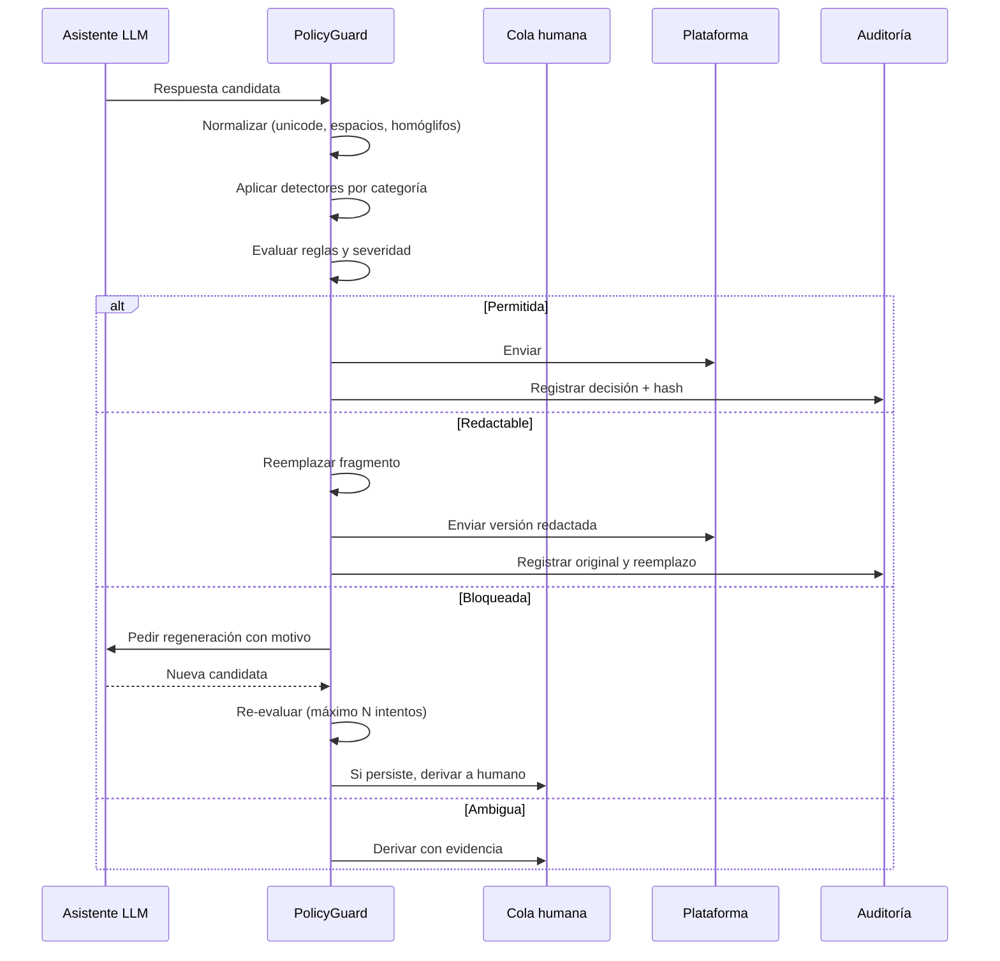
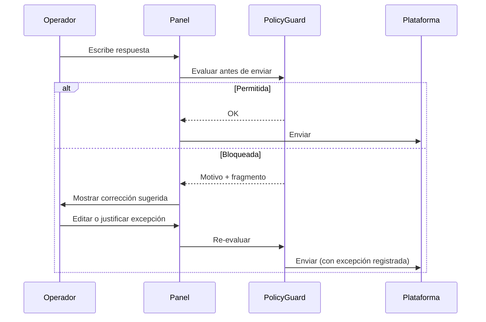

# 03 — Cómo funciona

Este documento describe los flujos completos, sin atarse a una implementación concreta. Los diagramas son de secuencia lógica, no de infraestructura.

## Flujo A — Mensaje entrante



Puntos importantes:

- **Idempotencia:** el mismo evento puede llegar dos veces. Se deduplica por identificador de mensaje.
- **Orden:** los mensajes de una conversación se procesan en orden por conversación, no globalmente.
- **Fallo de la plataforma:** si el webhook no llega, un proceso de reconciliación consulta el historial.
- **Dato original:** se guarda cifrado y con retención limitada; el modelo solo ve el enmascarado.

## Flujo B — Respuesta saliente



Reglas del flujo:

- **Máximo de reintentos:** dos. Un modelo que insiste en filtrar datos no se corrige con más prompts.
- **Presupuesto de latencia:** la evaluación determinística no puede agregar más de 150 ms p95. La segunda opinión con LLM es opcional y asíncrona cuando el riesgo lo permite.
- **Sin bypass:** ningún camino permite enviar sin evaluar. Si el motor no responde, se aplica el modo degradado definido por severidad.

## Flujo C — Mensaje de operador humano



La excepción existe porque hay casos legítimos que una regla no distingue. Pero una excepción **siempre** deja rastro: quién, cuándo, por qué y qué regla se omitió. Si se repite, se convierte en una regla nueva o en un falso positivo a corregir.

## Flujo D — Auditoría de historial

Sirve para dos cosas: incorporar un cliente que ya tiene conversaciones, y detectar deriva.

1. Se importa un lote de conversaciones (exportación de la plataforma o API).
2. Se evalúan con el pack de reglas actual, en modo observación.
3. Se genera un informe: fugas detectadas, categorías, frecuencia, ejemplos anonimizados.
4. Se prioriza: primero lo crítico, después lo recurrente.
5. El informe es, a la vez, entregable de la auditoría comercial y corpus de pruebas.

## Flujo E — Ciclo de vida de una política

```text
Detectar cambio ──▶ Redactar regla ──▶ Casos de prueba ──▶ Revisión
       ▲                                                        │
       │                                                        ▼
   Métricas ◀── Producción ◀── Canary ◀── Publicar versión ◀── Aprobar
```

- **Detección:** monitoreo de cambios en las políticas publicadas por la plataforma, reclamos de clientes, falsos negativos reportados.
- **Redacción:** la regla se escribe como dato, con severidad, detectores y acción.
- **Pruebas:** cada regla nueva trae casos positivos, negativos y de borde. Sin tests, no se publica.
- **Canary:** se aplica a un porcentaje del tráfico o a un tenant piloto.
- **Rollback:** volver a la versión anterior es una operación, no un deploy de código.

## Pipeline de decisión

Todo mensaje atraviesa las mismas etapas. El orden importa: de lo barato y determinístico a lo caro y probabilístico.

```text
1. Normalización
   └─ Unicode (NFKC), homóglifos, espacios, mayúsculas, emojis, leetspeak

2. Detección determinística
   ├─ Teléfonos (parseo por región, no solo regex)
   ├─ Emails (validación estructural)
   ├─ URLs (parseo, acortadores, dominios permitidos)
   ├─ Datos de pago (CBU, alias, IBAN, tarjetas)
   └─ Identificadores propios (números de pedido, códigos de producto)

3. Clasificación contextual
   ├─ ¿El número es un teléfono o un código de producto?
   ├─ ¿El link es al marketplace o externo?
   └─ ¿La frase invita a operar fuera del canal?

4. Segunda opinión (opcional)
   └─ Modelo pequeño o LLM solo para casos ambiguos, con salida estructurada

5. Evaluación de reglas
   └─ Severidad, scope, excepciones, versión de política

6. Decisión y acción
   └─ allow | redact | block | escalate

7. Registro
   └─ Decisión, evidencia, latencia, versión, trace_id
```

### Por qué este orden

- La normalización evita la mayoría de los bypass triviales.
- Los detectores determinísticos resuelven el 90% de los casos con costo casi nulo.
- El contexto evita falsos positivos sin sacrificar recall.
- El LLM es el último recurso porque es el más caro, el más lento y el menos auditable.
- La decisión se toma una sola vez, en un lugar, y se registra.

## Cola de revisión humana

No es un buzón: es una interfaz de trabajo.

- **Prioridad:** crítica primero, luego por antigüedad y por impacto económico de la conversación.
- **Contexto:** el revisor ve el mensaje, la respuesta propuesta, la regla que disparó, el fragmento exacto y la política aplicable.
- **Acciones:** aprobar, editar, rechazar, marcar falso positivo, escalar.
- **SLA:** medible. Si la cola crece, es señal de que hay reglas mal calibradas, no de que falta gente.
- **Aprendizaje:** cada decisión humana alimenta el corpus. Los falsos positivos repetidos se convierten en excepciones o en mejoras del detector.

## Registro de auditoría

Cada evaluación produce un registro inmutable con:

| Campo | Para qué |
|---|---|
| `trace_id` | Correlacionar mensaje, conversación y decisión |
| `tenant_id` | Aislar clientes |
| `platform` | Mercado Libre, Amazon, etc. |
| `conversation_id` / `message_id` | Reconstruir el hilo |
| `direction` | inbound / outbound / operator |
| `policy_version` | Saber qué reglas estaban vigentes |
| `rule_id` / `rule_version` | Explicar la decisión |
| `decision` / `action` | Qué se hizo |
| `evidence` | Fragmento, posición, detector |
| `latency_ms` | Medir el costo |
| `review` | Quién revisó, qué decidió, cuándo |
| `hash` | Integridad del registro |

El registro se escribe de forma append-only. Corregir un error no borra: agrega una enmienda.

## Modos de operación

| Modo | Qué hace | Cuándo se usa |
|---|---|---|
| **Observación** | Evalúa y registra, no bloquea | Primeras dos semanas, onboarding, auditoría |
| **Activo** | Bloquea y redacta según reglas | Producción madura |
| **Sombra** | Evalúa en paralelo y compara con lo enviado | Validar una versión nueva de política |
| **Emergencia** | Bloquea todo lo crítico y deriva | Incidente o cambio abrupto de la plataforma |

El modo es una decisión de producto del cliente, no un flag técnico escondido. Y siempre queda registrado quién lo cambió.
